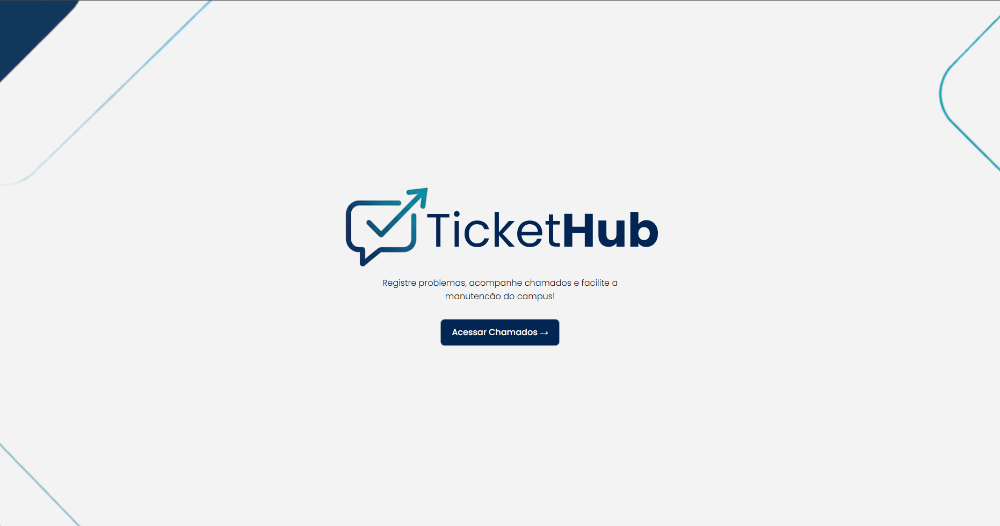
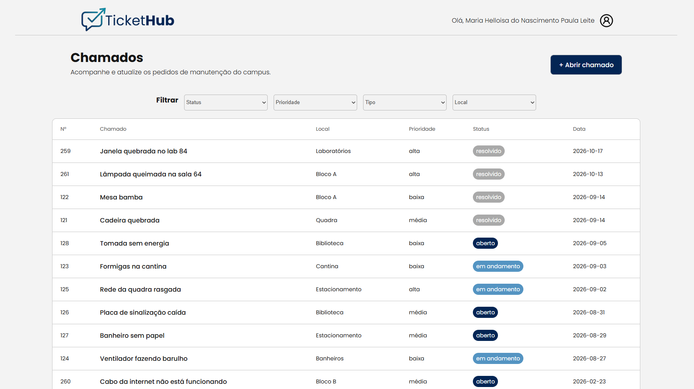

# ✦ TicketHub — Sistema de Gerenciamento de Chamados ✦

Sistema web desenvolvido para a disciplina de **Programação para Internet**, utilizando **React**, **Vite** e integração com uma API REST.

O **TicketHub** tem como objetivo facilitar o gerenciamento de chamados, permitindo visualizar ocorrências, consultar informações detalhadas e acompanhar o andamento de solicitações por meio de uma interface intuitiva e organizada.

O projeto aplica conceitos fundamentais do desenvolvimento front-end, como componentes reutilizáveis, navegação entre páginas, consumo de API, gerenciamento de estado e tratamento de erros.

---

## ✧ Tecnologias Utilizadas

- **React** — construção da interface por meio de componentes.
- **JavaScript** — implementação da lógica da aplicação.
- **Vite** — ambiente de desenvolvimento e build.
- **CSS** — estilização e organização visual das páginas.
- **Axios** — comunicação com a API REST.
- **React Router DOM** — navegação entre as páginas da aplicação.
- **API REST** — fornecimento e gerenciamento dos dados dos chamados.

---

## ✧ Screenshots

As capturas de tela abaixo apresentam algumas das principais páginas do TicketHub.

### Página de Apresentação



*Página inicial com a apresentação do sistema e acesso às funcionalidades.*

### Página de Chamados



*Página destinada à visualização e ao acompanhamento dos chamados cadastrados.*

---

## ✧ Funcionalidades

O TicketHub foi planejado para centralizar o gerenciamento de chamados em uma única aplicação.

- Página de apresentação do sistema.
- Listagem e visualização dos chamados.
- Consulta dos detalhes de cada chamado.
- Cadastro de novos chamados.
- Edição das informações de chamados, conforme seu status.
- Acompanhamento do status das solicitações.
- Registro do início do atendimento.
- Resolução e exclusão de chamados.
- Navegação entre páginas utilizando React Router DOM.
- Reutilização de componentes para manter a organização do código.
- Comunicação com a API por meio do Axios.
- Tratamento de erros durante as requisições.

---

## ✧ Rotas da Aplicação

A navegação entre as páginas é realizada por meio do **React Router DOM**.

| Rota            | Página              | Descrição                                          |
| --------------- | ------------------- | -------------------------------------------------- |
| `/`             | Apresentação        | Página inicial do sistema.                         |
| `/chamados`     | Chamados            | Lista os chamados disponíveis.                     |
| `/chamados/:id` | Detalhes do chamado | Apresenta as informações de um chamado específico. |
| `/novo`         | Novo chamado        | Formulário para cadastrar uma solicitação.         |
| `/editar/:id`   | Editar chamado      | Formulário para alterar um chamado existente.      |

---

## ✧ Integração com a API

O sistema utiliza uma API REST externa para consultar e executar operações relacionadas aos chamados.

**URL base da API:**

```text
https://api-chamados.jefersonqueiroga.com.br
```

A comunicação é realizada utilizando o **Axios**, configurado em um serviço centralizado. Essa abordagem facilita a reutilização da configuração e a manutenção das requisições.

### Principais operações

| Método HTTP | Endpoint                  | Descrição                                       |
| ----------- | ------------------------- | ----------------------------------------------- |
| `GET`       | `/eu`                     | Consulta as informações do usuário autenticado. |
| `GET`       | `/chamados`               | Lista os chamados.                              |
| `GET`       | `/chamados/{id}`          | Consulta um chamado específico.                 |
| `POST`      | `/chamados`               | Cadastra um novo chamado.                       |
| `PUT`       | `/chamados/{id}`          | Atualiza os dados de um chamado.                |
| `PATCH`     | `/chamados/{id}/iniciar`  | Inicia o atendimento de um chamado.             |
| `PATCH`     | `/chamados/{id}/resolver` | Registra a resolução de um chamado.             |
| `DELETE`    | `/chamados/{id}`          | Exclui um chamado.                              |
| `GET`       | `/tipos`                  | Consulta os tipos de chamados disponíveis.      |
| `GET`       | `/locais`                 | Consulta os locais disponíveis.                 |
| `GET`       | `/prioridades`            | Consulta as prioridades disponíveis.            |

A API também permite filtrar os chamados por parâmetros como status, tipo, local, prioridade e texto de busca, conforme as funcionalidades disponibilizadas pela documentação.

### Autenticação

As requisições utilizam uma chave de API enviada pelo cabeçalho `X-API-Key`. Para facilitar a configuração, a chave é definida em uma variável de ambiente.

Exemplo de configuração no arquivo `.env`:

```env
VITE_API_KEY=SUA_CHAVE_DA_API
```

---

## ✧ Como Executar o Projeto

### 1. Clone o repositório

```bash
git clone URL_DO_REPOSITORIO
```

Substitua `URL_DO_REPOSITORIO` pelo endereço real do repositório.

### 2. Acesse a pasta do projeto

```bash
cd tickethub
```

### 3. Instale as dependências

```bash
npm install
```

Caso as dependências ainda não estejam registradas no `package.json`, instale também:

```bash
npm install axios react-router-dom
```

### 4. Configure a chave da API

Crie um arquivo chamado `.env` na raiz do projeto e adicione sua chave:

```env
VITE_API_KEY=SUA_CHAVE_DA_API
```

Substitua o valor de exemplo pela chave disponibilizada para você. Não compartilhe essa chave publicamente.

### 5. Inicie a aplicação

```bash
npm run dev
```

O Vite exibirá no terminal o endereço local da aplicação, geralmente:

```text
http://localhost:5173
```

Abra esse endereço no navegador para utilizar o sistema.

---

## ✧ Conceitos Aplicados

Durante o desenvolvimento, são trabalhados conceitos importantes para a construção de aplicações web modernas:

- **Componentização:** divisão da interface em partes menores e reutilizáveis.
- **Props:** passagem de informações entre componentes.
- **Gerenciamento de estado:** controle das informações exibidas pela interface.
- **Requisições assíncronas:** comunicação com a API utilizando `async/await`.
- **Tratamento de erros:** identificação de falhas durante as operações.
- **Rotas:** organização da navegação com React Router DOM.
- **Consumo de API REST:** consulta, cadastro, atualização e exclusão de dados.
- **Organização do código:** separação entre páginas, componentes e serviços.

---

## ✧ Objetivo Acadêmico

O projeto tem como objetivo aplicar, na prática, os conhecimentos desenvolvidos na disciplina de **Programação para Internet**, por meio da criação de uma aplicação front-end integrada a uma API REST.

Além de trabalhar com React e suas ferramentas, o desenvolvimento busca exercitar a organização do código, a reutilização de componentes, a navegação entre páginas e a comunicação entre a interface e um serviço externo.

---

## ✧ Instituição

**IFRN — Instituto Federal de Educação, Ciência e Tecnologia do Rio Grande do Norte**

**Disciplina:** Programação para Internet

**Projeto:** TicketHub — Sistema de Gerenciamento de Chamados
